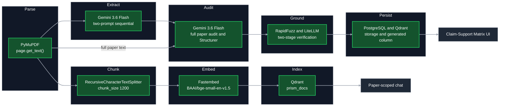
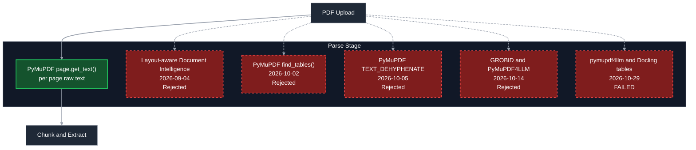
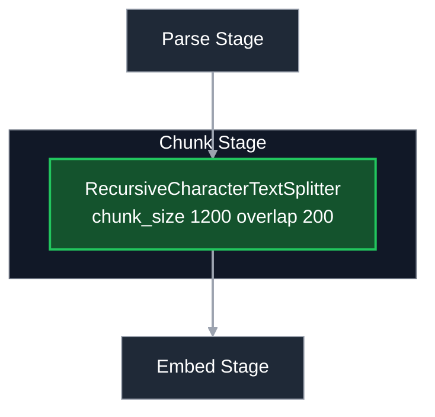
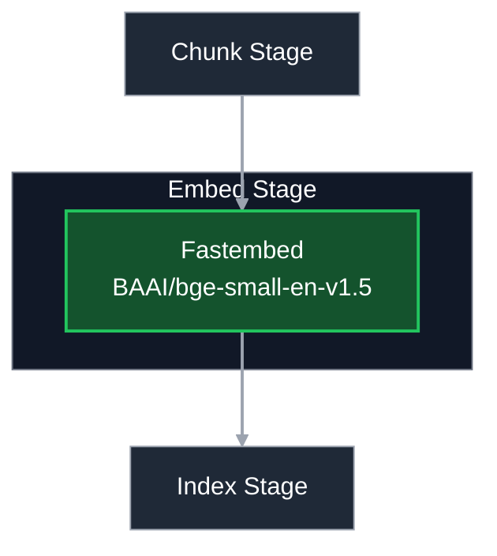
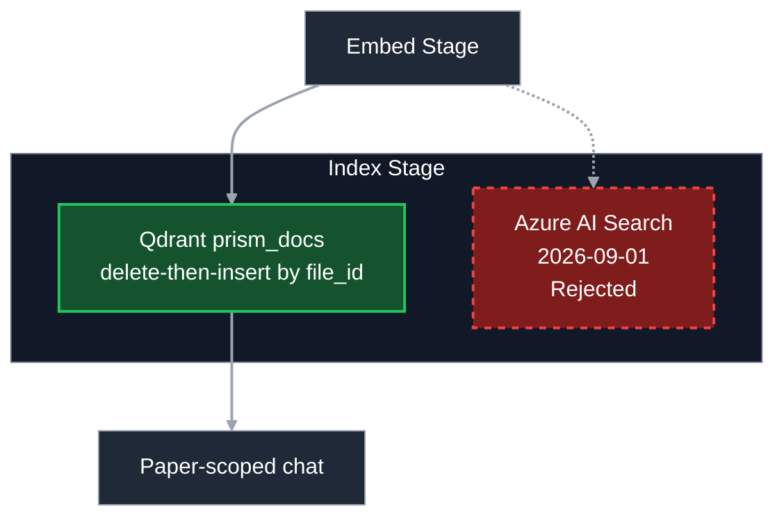
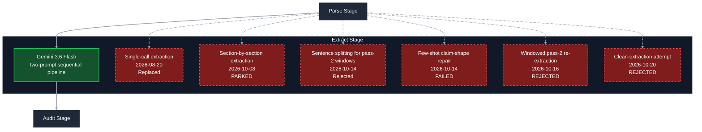
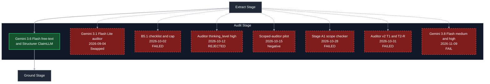
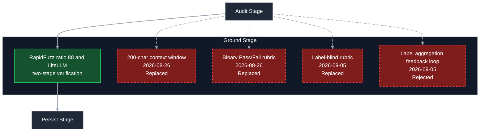
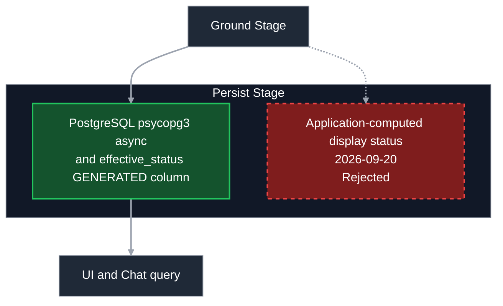
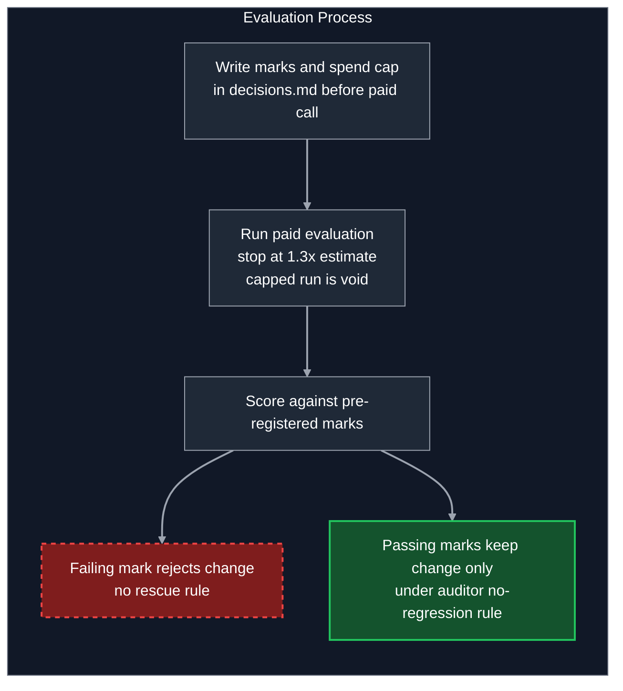

# Prism - Engineering Report
Nitin Yadav - 2026-11-09
<!-- hero diagram: added in a later step -->
*Every fact in this report is traced to its source entry in
docs/report/PRISM_FACTS.md and docs/decisions.md.*

## 1. Summary

- Prism reads one research paper, pulls out its claims, and checks each
  claim against the evidence in that same paper. It does a reviewer's
  check; it is not a search or summary tool.
- My 12-paper dev set contains 31 claims that their own paper does not
  fully support. In the one full run (dev Run 1, 2026-10-12), Prism
  flagged 8 of them (8/31, 26%). It wrongly flagged 4 of the 88 claims
  that are supported (false rejections 4/88).
- The release bar is one full 12-paper run with at least 22/31 flagged
  and at most 8/88 false rejections, with the fixes stable under the
  auditor no-regression rule. Prism does not meet it, and there is no
  release with the current auditor.
- Of the 23 misses, 13 are claims the extractor never pulled out and 10
  are claims the auditor wrongly passed as supported. A perfect auditor
  alone would reach 18/31 and perfect extraction alone 21/31, so both
  stages must improve.
- Every attempt so far to close this gap failed its pre-registered
  marks. The latest swapped in a newer model (gemini-3.8-flash): stricter
  judging caught more unsupported claims but also rejected more
  supported ones (up to 7/88).
- Cost is about INR 87-101 per paper against an INR 130 gate. Gemini
  Flash prices double on 2027-01-01 (about INR 87 -> 174 per paper),
  which would exceed the gate.
- Prism runs locally on .NET Aspire. The Azure deployment was
  decommissioned on 2026-09-28 to control cost. Next: this report and
  the pipeline diagram, then one new approach, pre-registered on its own.

### Key terms
- **Refusal-family row:** a test claim whose correct verdict is
  partially_supported or not_supported. Prism catches it if it labels
  the claim that way, or if grounding rejects the claim's quotes.
- **S row (supported row):** a test claim that the paper does support.
- **False rejection:** an S row that Prism marks as not fully supported.
- **Auditor miss:** the claim was extracted, but the auditor wrongly
  labelled it supported. **Extraction miss:** the claim was never
  extracted.
- **Positive hit:** an S row matched to a claim that passed audit and
  grounding.
- **Eval sets:** dev (12 papers, where experiments are judged), golden
  (3 papers, fast regression gate), held-out (1 paper, used 6 times),
  sealed (not built yet; reserved for the release number).
- **Pre-registration:** pass/fail marks and a spend cap written in
  docs/decisions.md before any paid run. A failed mark rejects the
  change. Codes such as M1, K4, or c4 are those marks, defined in each
  test's decisions.md entry.

Sources: docs/decisions.md - Live environment decommissioned (2026-09-28); docs/decisions.md - Dev run 1 - fixture dump and pre-registered adjudication rules (2026-10-12); docs/decisions.md - Auditor no-regression rule (2026-10-28); docs/decisions.md - Funding source and model plan for the next auditor tests (2026-11-02); docs/decisions.md - Full no-regression check result: FAIL for both 3.8 candidates; no auditor change (2026-11-09)

## 2. What Prism is and is not

Prism extracts empirical claims from a research paper and audits whether each claim is supported by evidence in that same paper. Unlike literature-discovery tools (Elicit, Consensus, Scite) that find and summarize across papers, Prism checks a single paper's headline findings against its own data and text. The engineering bet is correct refusal: vetoing any assessment the paper's own text does not support.

For every ingested paper, Prism outputs:
- **Claim-Support Matrix:** A structured grid of empirical and positioning claims extracted from the paper, paired with their verbatim evidence quotes, source sections, and auditor verdicts (`supported`, `partially_supported`, `not_supported`) displayed alongside grounding verification via `effective_status`.
- **Paper-scoped chat:** Overall verdict, overstated claims, and questions to scrutinize were collapsed from static cards into interactive paper-scoped chat embedded in the Matrix view, answered on-demand and grounded on `paper_claims` and Qdrant chunks for the active paper.

### Shipped Features

- **Paper-scoped chat agent:** LangGraph agent (`paper_chat/agent.py`) scoped to a single paper via `active_file_id`, querying `paper_claims` and Qdrant chunks, with fallback from FTS to claim position and loud refusal on empty retrieval.
  - *Status today:* Works in the local Aspire setup (`POST /api/chat/ask/stream` with LangGraph agent querying `paper_claims` and Qdrant chunks).
- **Streaming transport:** Server-Sent Events (SSE) token-by-token streaming transport over `POST /api/chat/ask/stream` with explicit `FlushAsync` chunk copying through ASP.NET Core.
  - *Status today:* Works in the local Aspire setup (SSE token-by-token streaming transport over `POST /api/chat/ask/stream` with explicit `FlushAsync`).
- **Chat UI in the matrix view:** Embedded chat strip (`PaperChatStrip.tsx`) in the Matrix workspace featuring streaming prose, clickable inline claim citations that highlight matrix rows and open the evidence drawer, and dynamic follow-up suggestions.
  - *Status today:* Works in the local Aspire setup (`PaperChatStrip.tsx` in Matrix workspace at `http://localhost:7000`).
- **Sign-in:** Customer-facing authentication via Microsoft Entra External ID (CIAM) supporting Google identity provider integration, resolving canonical identity through tenant-wide `oid` claims.
  - *Status today:* Built for the Azure deployment (decommissioned 2026-09-28); status in the local setup: not recorded.
- **One paper per chat:** Enforced at the API upload boundary (`POST /api/papers` rejects `Files.Count != 1`), establishing a 1:1 paper-to-chat model for unambiguous sidebar navigation.
  - *Status today:* Works in the local Aspire setup (enforced at upload endpoint `POST /api/papers` rejecting `Files.Count != 1`).
- **Ingestion progress events:** 5-stage progress event pipeline (`preparing` → `extracting` → `grounding` → `finalizing` → `done`/`failed`) emitted over RabbitMQ, broadcast to clients via SignalR groups, and rendered in `PaperActivityView`.
  - *Status today:* Works in the local Aspire setup (5-stage progress emitted over RabbitMQ, broadcast via SignalR groups, rendered in `PaperActivityView`).

### Known Product Gaps

The following recorded product gaps remain OPEN and unresolved:
- **Router non-determinism:** The same free-text phrasing sometimes routes to different `claim_lookup` modes across identical repeated calls; OPEN/unresolved.
- **generate_response hallucination on claim status:** `generate_response` answered incorrectly about claim support status even when correct claim data was in context, falsely stating entry was not provided; OPEN/unresolved.
- **Bug 4 (tab-switch/streaming state loss):** Live UI testing shows response can appear blank after switching browser tabs mid-stream and returning; suspected cause is Chromium suspending IntersectionObserver; OPEN/unresolved.
- **Streaming top-anchor effect doesn't reliably fire:** `scrollToAnchor()` in `PaperChatStrip.tsx` leaves `scrollRoot.scrollTop` frozen at pre-send value; OPEN/unresolved.

Local development hazard: claims data went missing from the local dev database (Postgres volume password drift).

### What Prism Is Not

- Prism is not a literature-discovery tool across papers.
- Prism is not a multi-paper chat tool (it enforces one paper per chat).
- Prism is not an arbitrary claim-generation engine without source grounding.

Sources: docs/decisions.md - One paper per chat, enforced at upload endpoint (2026-08-22); docs/decisions.md - Slice 3a: paper-scoped LangGraph chat agent, SSE transport, block output (2026-08-25); docs/decisions.md - Entra External ID (CIAM) (2026-09-15/16); docs/decisions.md - effective_status: Postgres GENERATED ALWAYS AS (...) STORED column (2026-09-20); docs/decisions.md - Live environment decommissioned (2026-09-28)

## 3. Architecture and pipeline

### 3.0 Runtime

Prism runs locally on .NET Aspire; there is no live URL. Subscription cancellation was initiated 2026-09-28, though confirmation of completion has not been confirmed.

Azure deploy was built 2026-09-01 (PR 5) across 7 Container Apps with Azure Postgres Flexible Server, Blob Storage, Key Vault, Managed Identity, and Application Insights. It was decommissioned 2026-09-28 because 7 always-on Container Apps (min replicas >= 1, 0.5 to 4 CPU) ran uncapped spend without scaling down between demos (pythonWorker ~40%, pythonAPI ~25%, 5 smaller containers ~30% including an unused Redis). Re-launch requires a reactivated Azure subscription, re-creating Entra External ID, Google IdP, and app registrations, and redeploying via `aspire deploy` and `Prism.Web/deploy.ps1`. The first Azure deploy (PR 5, 2026-09-01) hit 12 deployment issues, patched via az CLI.

### Component Architecture Table

| Component | Current | Tried / rejected (date, reason) |
|---|---|---|
| UI (Frontend) | React 19.2, TypeScript 5.9, Vite 7.3, Tailwind CSS 4.3; runs locally at `http://localhost:7000` | Hosted Azure Container App deployed 2026-09-01, decommissioned 2026-09-28 to stop uncapped spend. AddNpmApp publish deadlock required manual Docker build. |
| API Gateway | ASP.NET Core (.NET 10), EF Core; .NET Aspire 13.4.6 orchestration | Azure Container App deployed 2026-09-01, decommissioned 2026-09-28. |
| Worker | Python (`>=3.13`), FastAPI, LangGraph 1.0.9 | Azure Container App (2.0 CPU / 4Gi) deployed 2026-09-01, decommissioned 2026-09-28. Undersized 0.5 CPU/1Gi OOM crash-looped 2026-09-01. Wrong entrypoint ran api.py instead of main.py. |
| DB | PostgreSQL (local container via Aspire) with `GENERATED ALWAYS AS (...) STORED` column for `effective_status` | Azure Postgres Flexible Server (Entra Managed Identity auth) deployed 2026-09-01, decommissioned 2026-09-28. |
| Vector store | Qdrant (local container), fastembed | Azure AI Search rejected 2026-09-01 (Basic tier ~$250/month idle; Free tier caps at 50MB/3 indexes). Self-hosted Qdrant container in ACA deployed 2026-09-01, decommissioned 2026-09-28. |
| Queue | RabbitMQ (local container) with `main_prism_queue`, `dlx_prism_exchange`, `dlq_prism_queue` (TTL 60s), `prefetch_count=1` | Azure Service Bus swap attempted 2026-08-31 / 2026-09-01 in PR 4; surfaced 4 bugs in emulator + Python SDK (microsoft/aspire#14041), reverted. ACA Azure Files volume mount failed Erlang cookie permissions (0600), fixed by running without data volume. |
| Cache / Other | Azurite (local blob emulation) | Redis provisioned in AppHost.cs:30 but caching logic never implemented. Decommissioned with Azure stack. |

### 3.1 Overview Diagram and Pipeline Stages

The end-to-end ingestion pipeline processes academic PDF papers through two parallel pathways: an extraction and verification pipeline that extracts claims and audits them against the full paper text, and a retrieval-augmented generation (RAG) indexing pipeline that chunks and embeds the document for conversational interrogation.

Green: current path. Grey: context.

The document ingestion pipeline processes papers through eight stages:
1. **Parse:** PyMuPDF extracts raw text page by page.
2. **Chunk:** `RecursiveCharacterTextSplitter` creates 1,200-character windows (200 overlap).
3. **Embed:** Fastembed computes dense embeddings via `BAAI/bge-small-en-v1.5`.
4. **Index:** Chunks are indexed in Qdrant `prism_docs` for chat retrieval.
5. **Extract:** Gemini 3.6 Flash runs a sequential two-prompt pipeline for metadata and claims.
6. **Audit:** Gemini 3.6 Flash audits claims against full paper text; the Structurer parses schema.
7. **Ground:** Two-stage RapidFuzz and LiteLLM verification checks evidence spans without altering stored audit labels.
8. **Persist:** PostgreSQL stores claims and statuses (`effective_status` generated column); Qdrant stores vectors.

### 3.2 Parse

The current parser uses PyMuPDF (`fitz` v1.26.7) via `page.get_text()` appended per page in `main.py:114`. This extracts raw text directly from the PDF stream without layout-aware reconstruction or external services. Raw text preserved table citations (such as "Supervised SoTAb 67.5 89.5").

Green: current path. Red dashed: tried and failed or rejected. Grey: context.

| Approach | Date | Result | Status |
|---|---|---|---|
| PyMuPDF `page.get_text()` | in use | Extracts raw page text; preserves raw table citations | Current |
| Layout-aware PDF parsing via Document Intelligence | 2026-09-04 | Rejected because raw PyMuPDF text preserved table citations (e.g. "Supervised SoTAb 67.5 89.5") | Rejected |
| PyMuPDF `find_tables()` | 2026-10-02 | Evaluated; left 2 of 4 tables undetected and merged rows; raw `get_text()` was cleaner | Rejected |
| PyMuPDF `TEXT_DEHYPHENATE` | 2026-10-05 | Evaluated; alters text globally across extraction, chunking, and embedding simultaneously without fixing ligatures or table breaks | Rejected |
| GROBID 0.9.0 & PyMuPDF4LLM | 2026-10-14 | Evaluated in Experiment 3 pre-checks Check D/E; raw ceiling 112/119 vs GROBID 81/119 and PyMuPDF4LLM 77/119; rejected | Rejected |
| Off-the-shelf table extraction (pymupdf4llm 1.28.2 & Docling 2.144.0) | 2026-10-29 | Evaluated in Auditor v2 T1; both failed (5/8 usable tables each, lost row-group spans) | Failed |

**Open issues:**
- PyMuPDF text fusion artifacts across line breaks ("muchhigher", "trustworthiness.").
- Injected running headers, line-end hyphen splits, mid-sentence tables, and lone numbers.
- Raw reader loses 7 development benchmark rows before any text splitting occurs.

### 3.3 Chunk

The chunk stage uses `RecursiveCharacterTextSplitter` (`chunk_size = 1200`, `chunk_overlap = 200`, separators `["\n\n", "\n", r"(?<=\. )", " ", ""]`, length `len`). It creates character-based chunks with deterministic `uuid5(NAMESPACE_DNS, f"{file_id}:{i}")` chunk IDs in Qdrant. This enables clean delete-then-insert idempotency. No alternatives were tested.

Green: current path. Red dashed: tried and failed or rejected. Grey: context.

| Approach | Date | Result | Status |
|---|---|---|---|
| RecursiveCharacterTextSplitter (1,200 chars / 200 overlap) | in use | Character-based chunking with deterministic uuid5 chunk IDs | Current |

**Open issues:**
- Page structure is lost when text is concatenated for chunking.
- `evidence_spans.page_number` and `evidence_spans.section_header` remain null across extracted claims.

### 3.4 Embed

Prism computes dense embeddings locally using Fastembed `TextEmbedding(model_name="BAAI/bge-small-en-v1.5")`. Vectors have 384 dimensions and are compared using cosine distance. No alternatives were tested.

Green: current path. Red dashed: tried and failed or rejected. Grey: context.

| Approach | Date | Result | Status |
|---|---|---|---|
| Fastembed `BAAI/bge-small-en-v1.5` | in use | Vector size 384, cosine distance | Current |

### 3.5 Index

The index stage uses a local Qdrant vector database (`AsyncQdrantClient`) in single collection `prism_docs`. It executes delete-then-insert by `file_id` filter payload before upserting chunk vectors. This prevents orphan vectors on re-indexing.

Green: current path. Red dashed: tried and failed or rejected. Grey: context.

| Approach | Date | Result | Status |
|---|---|---|---|
| Qdrant (`prism_docs` collection) | in use | Async client, delete-then-insert by `file_id` payload filter | Current |
| Azure AI Search | 2026-09-01 | Evaluated; rejected due to cost ($250/month idle Basic tier) and quota limits (50MB / 3 indexes Free tier) | Rejected |

**Open issues:**
- Cross-file Qdrant isolation is not implemented; all papers share the single `prism_docs` collection.

### 3.6 Extract

Extraction runs Google Gemini 3.6 Flash via two-prompt sequential execution in `extraction/engine.py`. Prompt 1 (`extract_metadata`) extracts metadata, while Prompt 2 (`extract_claims`) captures empirical and positioning claims with a ceiling of 25-45. It outputs `claim_text_verbatim` and `claim_summary`.

Green: current path. Red dashed: tried and failed or rejected. Grey: context.

| Approach | Date | Result | Status |
|---|---|---|---|
| Gemini 3.6 Flash two-prompt sequential execution | in use | Sequential metadata and claim extraction; ceiling 25-45 | Current |
| Single-call extraction | 2026-08-20 | Failed to emit refusal labels (0 by_label); short-circuited reasoning; replaced by 3-call pipeline | Replaced |
| Section-by-section extraction | 2026-10-08 | Evaluated; parked due to 3.1x cost and miss rows sitting in early sections | Parked |
| Few-shot claim-shape repair (Exp 2) | 2026-10-14 | Evaluated; all 4 required marks failed; flags `EXTRACTOR_FEWSHOT_FIX` and `EXTRACTOR_FEWSHOT_SHAPES` stay off | Failed |
| Sentence splitting for pass-2 windows (pysbd and regex, Exp 3 pre-checks) | 2026-10-14 | Check A: best regex 75.6% WHOLE; rejected for fixed windowing | Rejected |
| Windowed pass-2 re-extraction (Exp 3) | 2026-10-16 | Evaluated; rejected on cost gate c4 | Rejected |
| Clean-extraction attempt (Exp 3 + pass-2 clean filter) | 2026-10-20 | Evaluated; rejected on K1, K4, K7, K8; `EXTRACTOR_PASS2_CLEAN` stays off | Rejected |

**Open issues:**
- `prompt_loader.py:58` treats few-shot examples with `"note"` field as negative, blanking 8 of 9 examples (PR #115 unmerged).
- Extractor misses 13 development benchmark refusal rows.
- Three known risks in clean extraction code ("same"-relation chain-drop, unvalidated neighbor ids, positional answer mapping).

### 3.7 Audit (including Structurer)

The auditor runs Gemini 3.6 Flash free-text reasoning per claim over the full paper text in `prompts/audit_claim_system.md`, outputting `VERDICT: supported|partially_supported|not_supported` plus `QUOTE:` / `SECTION:` pairs. The Structurer (Gemini 3.6 Flash with Pydantic `response_schema` `ClaimLLM`) parses this output into typed objects. Audit and structure concurrency is capped by `AUDIT_STRUCTURE_CONCURRENCY = 5`.

Green: current path. Red dashed: tried and failed or rejected. Grey: context.

| Approach | Date | Result | Status |
|---|---|---|---|
| Gemini 3.6 Flash free-text reasoning + Structurer | in use | Free-text reasoning over full text with Pydantic JSON structuring | Current |
| Gemini 3.1 Flash Lite auditor | 2026-09-04 | Swapped to Gemini 3.6 Flash after underperforming on trap claims | Replaced |
| B5.1 auditor checklist + deterministic verdict cap | 2026-10-02 | Evaluated; failed pre-registered marks; archived on tag `archive/b5.1-checklist-attempt` | Failed |
| Auditor `thinking_level=high` (Exp 1) | 2026-10-12 | Evaluated; fixed only 1 of 10 rows (needed >= 3); rejected; `AUDITOR_THINKING_LEVEL` stays unset | Rejected |
| Scoped-auditor pilot | 2026-10-15 | 1 run, 44 claims, ~INR 204; failed P3 (4 of 11 baseline refusals flipped to supported); archived on tag `archive/exp1-scoped-auditor` | Failed |
| Auditor Stage A1 (caching + scope lister + scope checker) | 2026-10-28 | Evaluated; failed (fixed 3/10 misses, 1/6 always-missed vs 4 needed); flags stay off | Failed |
| Auditor v2 T1 & T2-R (code checks on tables) | 2026-10-31 | T1 failed 2026-10-29 (extractor infidelity); T2-R on LaTeX reference tables failed 2026-10-31 (fixed 4/10 misses, 2/5 hard vs 3 needed) | Failed |
| Gemini 3.8 Flash auditor (medium & high) | 2026-11-09 | Full check failed on M3, M4, M7; auditor stays Gemini 3.6 Flash | Failed |

**Open issues:**
- Full-scope checking gap: auditor does not verify claim scope against reported evidence and accepts bold summary averages.
- Sends full paper text once per claim (measured partial share ~90-96% of input tokens; an earlier 75% figure was an estimate).
- Run-to-run noise at default medium thinking (~±3 rows).
- Full-pipeline token usage is not logged in production.

### 3.8 Ground

Grounding never changes the stored audit label; `label` is set exclusively by the auditor and passed through unmodified, untouched by grounding. Grounding sets `grounding_status` (`Pass`/`Partial`/`Fail` rollup on `ClaimFinal`, setting `missing=true` when a claim fails), `stance` (`supports`/`refutes`/`neutral` on `EvidenceSpanFinal`), and `reason`. In PostgreSQL, `effective_status` is a `GENERATED ALWAYS AS (...) STORED` column that overrides only the display presentation when `missing=true`, while `label`, `missing`, and `grounding_status` remain unchanged in storage. The eval counts a refusal-family catch as `by_grounding` when a claim was emitted and grounding rejected it (`missing=true`), checked before label, on a grounding-negative row. Current verification runs two stages in `extraction/grounding.py`: Stage 1 RapidFuzz `partial_ratio` (threshold 88) with `GROUNDING_NORMALIZE`, and Stage 2 LiteLLM (`groq/openai/gpt-oss-20b`, fallback `gemini-3.1-flash-lite`, `AUDIT_CONCURRENCY = 1`) evaluating quoted context snapped 500-1500 chars with 3-tier verdict (`Pass`/`Partial`/`Fail`) and required `stance` (`supports`/`refutes`/`neutral`).

Green: current path. Red dashed: tried and failed or rejected. Grey: context.

| Approach | Date | Result | Status |
|---|---|---|---|
| RapidFuzz (threshold 88) + LiteLLM 3-tier stance | in use | Two-stage verification; does not modify stored label | Current |
| 200-character fixed context window without snapping | 2026-08-26 | Evaluated; caused ~100% false rejections; replaced by 500-1500 char snapping | Replaced |
| Binary Pass/Fail rubric | 2026-08-26 | Replaced with 3-tier Pass/Partial/Fail | Replaced |
| Label-blind rubric | 2026-09-05 | Evaluated; refuting evidence was marked Fail; replaced with label-conditioned rubric | Replaced |
| Label aggregation feedback loop (`_label_from_verdicts`) | 2026-09-05 | Rejected to preserve acyclic architecture | Rejected |

**Open issues:**
- Cell-skipping quotes can pass `partial_ratio` (e.g. `ReAct (best of 6) 71` scores 90.0 against full row).
- Groq free tier 8K TPM / 200K RPD pushes most calls to Gemini Flash Lite fallback.
- Sends `temperature=0` when Google advises 1.0 for Gemini 3.

### 3.9 Persist

The persistence stage writes claims, evidence spans, and processing states to PostgreSQL (`paper_claims`, `document_extractors`, `file_records`) using `psycopg3` async connection pools, while chunk vectors are persisted to Qdrant. The ASP.NET Core API gateway reads these records using EF Core through dedicated `ValueConverter` classes (`ClaimLabelConverter`, `GroundingStatusConverter`) and `HasJsonPropertyName` for JSONB owned entities. PostgreSQL computes `effective_status` via a `GENERATED ALWAYS AS (...) STORED` column directly in the database engine, ensuring that display state resolution is deterministic across languages.

Green: current path. Red dashed: tried and failed or rejected. Grey: context.

| Approach | Date | Result | Status |
|---|---|---|---|
| PostgreSQL generated column + Qdrant | in use | `effective_status` computed in DB via `GENERATED ALWAYS AS (...) STORED` | Current |
| Application-computed display status in C#/Python | 2026-09-20 | Rejected in favor of Postgres generated column to prevent cross-language drift | Rejected |

**Open issues:**
- `SubmitPaperEndPoint` commits the DB row before publishing `PrismUploaded` to RabbitMQ with no MassTransit transactional outbox; publish failure leaves rows permanently stuck at `InProgress`.
- Postgres container password drift on local restarts.
- `document_extractors.latest_run_id` is self-referential and misleading.

Sources: docs/decisions.md - Two-prompt extraction (metadata + claims) with shared engine helper (2026-08-08); docs/decisions.md - First Azure deploy (2026-09-01); docs/decisions.md - Auditor model swap + eval matcher calibration (2026-09-04); docs/decisions.md - effective_status: Postgres GENERATED ALWAYS AS (...) STORED column (2026-09-20); docs/decisions.md - Live environment decommissioned (2026-09-28)

## 4. Models

The following table summarizes the models configured across Prism's pipeline roles, including active production choices and evaluation infrastructure:

| Role | Model id | Provider / API path |
|---|---|---|
| Extraction | gemini-3.6-flash | Google Gemini API (paid Tier 1) |
| Audit | gemini-3.6-flash | Google Gemini API (swapped from gemini-3.1-flash-lite) |
| Structurer | gemini-3.6-flash | Google Gemini API |
| Grounding primary | groq/openai/gpt-oss-20b | Groq API via LiteLLM (concurrency 1, free tier 30 RPM, 8K TPM ceiling) |
| Grounding fallback | gemini-3.1-flash-lite (provider route gemini/gemini-3.1-flash-lite; in eval, grounding primary and fallback were both gemini-3.1-flash-lite via $env:LLM_GROUNDING_MODEL) | Google Gemini API via LiteLLM fallback chain |
| Audit fallback | gemini-3.1-flash-lite | Google Gemini API |
| Eval backend | Google AI Studio (product/dev); Vertex AI (eval experiments, project gen-lang-client-0520352487, global) | Google Cloud Vertex AI (billed to GCP Free Credit) |

### Tested, Not Adopted

- **gemini-3.1-flash-lite (as primary auditor):** Replaced 2026-09-04 after underperforming on trap claims.
- **gemini-2.5-flash-lite (as matcher default):** Retired by Google; calls 404'd; fixed 2026-09-04.
- **groq/llama-3.1-8b-instant:** Deprecated by Groq 2026-06-17, shut down 2026-08-16; replaced by `groq/openai/gpt-oss-20b` before deployment.
- **Local Ollama:** Tested conceptually 2026-08-27; rejected due to hardware variability and eval confounding.
- **NLI model fine-tuning:** Evaluated 2026-09-04; rejected because 17 labeled rows were insufficient and NLI pair-classification cannot detect absence.
- **gemini-3.8-flash (medium thinking):** Tested in Vertex screen (attempt 2 voided 2026-11-07) and Full check 2026-11-08/09; REJECTED on M3 (4 false rejections /88 vs baseline 1).
- **gemini-3.8-flash (high thinking):** Tested in Vertex screen (attempt 2 voided 2026-11-07) and Full check 2026-11-08/09; REJECTED on M3 (7 false rejections /88), M4 (positives 10/21 < floor 11), and M7 (cost INR 194.4/paper vs 130 cap).
- **gemini-4-argon:** Ruled out 2026-11-02 due to cost (~2.7x to 5x Flash) and lack of explicit caching support.

Sources: docs/decisions.md - Hybrid Gemini paid Tier 1 + Groq audit (2026-08-27); docs/decisions.md - Auditor model swap + eval matcher calibration (2026-09-04); docs/decisions.md - Funding source and model plan for the next auditor tests (2026-11-02); docs/decisions.md - Pre-registration: full 3-run no-regression check, gemini-3.8-flash medium and high vs gemini-3.6-flash, Vertex (2026-11-08); docs/decisions.md - Full no-regression check result: FAIL for both 3.8 candidates; no auditor change (2026-11-09)

## 5. Evaluation design

The evaluation is the main deliverable of this project. Every experiment
has its pass/fail marks and a rupee spend cap written in
docs/decisions.md before any paid call. A failing required mark rejects
the change: no partial credit, no re-runs, and no threshold edits to
save a result. Auditor changes must also pass the no-regression rule
over three runs.

### Evaluation Sets

Prism uses four evaluation sets:

| Set | Papers | Total Rows | Refusal-family Rows | Supported (S) Rows | Times Used | Status |
|---|---|---|---|---|---|---|
| Dev | 12 | 119 | 31 (4 not_supported, 27 partially_supported; ~30 independent) | 88 | 1 full pipeline run (plus multiple replays) | Active dev benchmark (frozen 2026-10-11, hash cb3272cce551) |
| Golden | 3 (Reflexion, CoT, ReAct) | 37 | 16 (strict 16) | 21 | Multiple runs; frozen fixtures re-dumped 2026-10-07 | Active fast regression gate (de-leaked, hash cb3272cce551) |
| Held-out | 1 (arXiv 2609.20812v3) | 12 | 2 (0 not_supported, 2 partially_supported: M04, M06) | 10 | Used 6 times | Near-burnt; last look before trusting generalization |
| Sealed | 3-4 papers | not recorded | not recorded | not recorded | 0 | Reserve fund allocated (INR 300); unbuilt / unrun |

### Metric Definitions

Evaluation outcomes are categorized according to seven formal metrics:

- **Refusal-family catch:** An emitted claim whose grounding rejected it (`by_grounding`) OR whose label is `not_supported` or `partially_supported` (`by_label`) on a grounding-negative golden or development benchmark row.
- **Auditor miss:** A claim that was extracted and matched to a refusal row, but was incorrectly labeled `supported` by the auditor and not vetoed by grounding.
- **Extraction miss:** A target ground-truth row where no matching claim was emitted by the extractor.
- **False rejection:** A supported (S) row where the claim was incorrectly judged unsupported (either by having its label lowered or by being vetoed by grounding).
- **Positives (Positive hits):** A supported golden or development row matched to an emitted claim that passed both audit and grounding verification.
- **Needs review:** An ambiguous code-check outcome (such as a missing cell, unparsable cell, member in another table, exact tie on strict comparison, or kept caveat); only replaces Supported; never counted as a catch, positive hit, or false rejection.
- **Coverage:** The share of evaluation set rows with confirmed human adjudication in the match map; coverage below 100% suppresses the headline percentage and forces exit code 1 in test harnesses.

### Evaluation Rules

Every technical experiment in Prism is governed by a numbered sequence of operational rules:

1. **Pre-registration process:** Every experiment must have written pass/fail marks and an explicit rupee spend cap logged in `docs/decisions.md` before any paid API call is initiated.
2. **No-rescue rule:** A failing required mark rejects the change outright; no partial credit, no re-running, and no threshold edits are permitted to save a result.
3. **Auditor no-regression rule:** An auditor modification is KEPT only if all of the following conditions hold over three identical runs:
   - *Gain:* At least 1 more of the 10 auditor misses is fixed in >= 2 of 3 runs versus the current floor.
   - *No lost catches:* Each of today's 8 caught refusal rows remains caught in >= 2 of 3 runs.
   - *False rejections:* No worse than the flag-off baseline and never above 8/88.
   - *Golden gate:* Golden refusal catches >= 5/16 and positive hits >= 11/21 in >= 2 of 3 runs.
   - *Grounding-negative:* Any FAIL on grounding-negative checks blocks the change.
   - *Not overfit:* Targets a recognized failure TYPE without special-casing individual evaluation rows.
   - *Subsequent amendments and additions (on/after 2026-10-28):*
     - *Needs-review scoring amendments (2026-10-28):* Needs review is never a catch; a refusal row ending in Needs review is not caught (stays in denominator); an auditor miss ending in Needs review is not fixed; a caught refusal row ending in Needs review is a lost catch; Needs review on an S row is not a false rejection but counts toward the ceiling; Needs review is not a positive hit; ceiling added: Needs review on development S rows <= 8/88 in >= 2 of 3 runs, and <= 10% of all audited claims in every run.
     - *Miss targets and noise exclusions (2026-11-02, 2026-11-08):* P1-R3 is excluded from the real caught hits total (M2) as documented run-to-run noise (scored out of 7 real hits); P5-R1 (figure) and P5-R2 (duplicate) are parked, reducing active miss targets from 10 to 8.
     - *Fresh baseline for false rejections (2026-11-07, 2026-11-08):* M3 false rejections are evaluated against a fresh parallel baseline measured in the same evaluation run (1/88), rather than run 1's 4/88.
     - *Bounded fallback scoring and crash recovery (2026-11-08):* Fallback-served audits are scored bounded as worst-case for candidate and best-case for baseline (D9 rule); an evaluation arm is void if > 16 fallback-served audits occur (V3); rule V5 permits re-running a single failed repeat $K$ with `--repeat-index K` and `--max-inr` capped at one-third of the run's cap.
     - *Cost gate addition (2026-11-08):* Mark M7 requires projected full-pipeline cost per paper to remain <= INR 130.
4. **Release bar (restated 2026-10-22):** For development: one full 12-paper run reaches >= 22/31 refusal-family rows with false rejections <= 8/88, and all fixes remain stable under the auditor no-regression rule. The final release score must be measured on a single sealed-set run only, never development or golden numbers.
5. **Cost gate:** Projected full-pipeline cost per paper must be <= INR 130.
6. **Paid-run stop rule (1.3x estimate):** Stop any paid run immediately if actual spend exceeds 1.3x its estimate.
7. **Capped run = void:** A run stopped by a budget cap is void and provides no result; rescue re-runs are prohibited without a new dated decisions log entry.
8. **Sealed reserve:** An untouchable allocation of INR 300 is reserved exclusively for final evaluation on unseen papers, protected from development pushes.

### Labelling Process

Labelling:
- Development benchmark rows were hand-labelled under a written rubric (`docs/LABEL_RUBRIC.md`) before any Prism output was observed.
- Golden rows were hand-audited against original PDFs and corrected only where the paper explicitly contradicted them.
- Initial pairings and labels were produced using blind dual-AI judges (ChatGPT and Gemini), after which I (Nitin) adjudicated disagreements and spot-checked claims.
- All final splits and adjudications across development rows and held-out files were decided by me.

### Evaluation Process Diagram

Green: change kept. Red dashed: change rejected. Grey: steps.

Sources: docs/decisions.md - 12 golden-eval corrections after hand-auditing all 3 papers (2026-10-01); docs/decisions.md - Release targets, order of work and stop rule amended (2026-10-10); docs/decisions.md - Dev set frozen (2026-10-11); docs/decisions.md - Auditor no-regression rule (2026-10-28); docs/decisions.md - Pre-registration: full 3-run no-regression check, gemini-3.8-flash medium and high vs gemini-3.6-flash, Vertex (2026-11-08)

## 6. Every test and its result

Each row is one pre-registered test. Codes in the Key result column
(M1, K4, c4, A1 and similar) are that test's pass/fail marks, defined
in its decisions.md entry.

### Table A: Tests from 2026-10-07 onward

| Date | Test | What changed | Key result | Verdict | Cost | Note |
|---|---|---|---|---|---|---|
| 2026-10-07 | De-leak PR-B | Removed eval paper text & answer keys from prompts | Golden: refusal-family 5/16 (0.3125), strict 5/16, wrongly affirmed 4, not extracted 7, positive hits 11/21 (floor 10), false rejection 1/21, coverage 37/37; Held-out: 1/2, 7/10, 0/10, 12/12; gate reset 0.35 -> 0.30 after result under pre-registered rule | Passes by one row | not recorded | |
| 2026-10-08 | PR-1 | Few-shot loader "note" fix | Golden FULL mean 20.4->20.6; GN FULL mean 9.6->8.8; M1 FAIL, M2 FAIL | FAIL (kept as correctness fix) | not recorded | extractor-only harness measuring extraction recall, not comparable to end-to-end refusal scores [D: "PR-1 result (negative): few-shot loader fix, no coverage gain" - 2026-10-08] |
| 2026-10-08 | Section-by-section extraction | Feasibility check for section-by-section extraction to reach late-paper claims | Feasibility confirmed; 3 of 4 missed refusal rows sit in sections 1-2; at most 1 row would gain; cost 3.1x extractor input, 48 calls/run | PARKED | INR 0 | feasibility check only, not a pipeline eval run [D: "Section-by-section extraction: feasibility confirmed, then PARKED" - 2026-10-08] |
| 2026-10-11 | Baseline Run 1 Pilot | 4 of 12 dev papers uploaded | 4 papers cost INR 405.55 (~INR 101/paper); 139 claims: 135 S, 4 PS, 0 NS | Paused | INR 405.55 | |
| 2026-10-12 | Dev Baseline Run 1 | Ingested remaining 8 dev papers (12 total) | Refusal 8/31 (26%); 10 audit misses, 13 extraction misses; FR 4/88 effective | PASS (as baseline) | INR 11.38 matcher calls; ~INR 1,048.40 total | |
| 2026-10-12 | Exp 1 (Control medium x2) | Auditor thinking default (medium) replay | Hits 8 (run 1), 7, 5; spend 1.79x estimate | Pre-registered stop triggered | INR 155.11 | |
| 2026-10-12 | Exp 1 (High x3) | Auditor `thinking_level=high` | Fixed 1/10 (P1-R1), lost hits 0/8; raw hits 10, 10, 10 | FAIL | INR 256.84 | |
| 2026-10-14 | Exp 2 (Redesigned) | Extractor few-shot claim shapes (8 new examples) | A1 FAIL (1/13, 1/13), A2 FAIL (-2), A3 FAIL (11/13, 9/13), A4 PASS (285, 287 vs 463.5) | FAIL | INR 177.93 | |
| 2026-10-14 | Exp 3 pre-checks | Checks A (splitters), B (sentence count), C (union), D (readers), E (failure diagnosis) | Check A FAILED (best regex 75.6%); Check D FAILED (fixed windows 6000/1500 chars 94.1% WHOLE, 112/119 vs 112 raw ceiling); Check E: 7 NOT_FOUND identical to raw reader loss; ceilings: raw 112/119, GROBID 81/119, PyMuPDF4LLM 77/119 | Both FAILED (Checks A & D) | INR 0 | local text split/reader survival check, not an auditor/extraction pipeline score [D: "Experiment 3 pre-checks result" - 2026-10-14] |
| 2026-10-15 | Scoped-auditor pilot | Scoped auditor tested on 44 claims (AUDIT_MODE) | 1 run, 44 claims; Failed P3: 4 of 11 baseline refusals flipped to supported | Negative result | ~INR 204 | unmerged pilot on legacy baseline, predates de-leak and scorer fix [D: "Backfill: records missing from this log" - 2026-10-15] |
| 2026-10-15 | Exp 3 Pilot 1 | Pass-2 windowed extraction, default thinking | 26 windows completed, 128 sentences, crash on mkdir | Aborted / Crashed | INR 40.12 (meter) | |
| 2026-10-15 | Exp 3 Pilot 2 | Pass-2 thinking LOW, frozen pass 1 | 34/34 windows, 124 sentences (windows 1-26), INR 0.37/window | PASS | INR 12.52 (meter) | |
| 2026-10-15 | Exp 3 pass2_r1 | 12 dev papers, pass 2 thinking LOW | 261 windows, 1,114 sentences, 962 merged claims; c4 projected INR 243 > 130 | Gated run | INR 66.75 (meter) | |
| 2026-10-16 | Exp 3 pass2_r2 | 12 dev papers, pass 2 thinking LOW | 261 windows, 1,111 sentences, 969 merged claims; c4 projected INR 245 > 130 | Gated run | INR 66.40 (meter) | |
| 2026-10-16 | Exp 3 B4 | Scoring pass 2 runs | c4 FAIL (INR 237.59 pooled / 243.75 mean vs 130); c7 PASS (0.987 / 0.989); c2 18/18; c1/c6/c8 not measured | REJECTED | INR 0 | |
| 2026-10-16 | Exp 3 c1/c6 (Exploratory) | AI-proposed, human-verified matching on c1 | c1: r1 8/13, r2 8/13 (PASS); c6: r1 8/13, r2 8/13 (PASS) | Exploratory only (not a PASS) | INR 0 | |
| 2026-10-18 | Clean Attempt Pilot | Single-paper comparison (2610.10590v1) | Key B: gain 19.23 pp, prec 0.833; Key A: gain 19.18 pp, prec 0.778 | KEEP | INR 4.4 | |
| 2026-10-20 | Clean-Extraction Attempt | Pass-2 clean filter on Exp 3 outputs | K1 FAIL (5/13, 6/13); K2 PASS (18/18); K3 r 2.50/2.47; K4 FAIL (INR 230.52/227.55); K5 PASS (0.991); K6 PASS (0.81-0.95); K7 FAIL (43/18 not-same); K8 FAIL (INR 64.25/58.31 vs 40) | REJECTED | INR 311.04 | |
| 2026-10-26 | Stage A0 | Explicit context caching on 18 frozen claims | M1 PASS (0 failed calls, 414,204 tokens cached); M2 PASS (INR 1.30 vs 3.79, 66% below); M3 PASS (8/31) | PASS | INR 36.86 (Google SKU report) | |
| 2026-10-27 | Cache + Schema Probe | Single cached request with response_schema + thinking low | PASS: parsed ProbeOut, 13,125 cached tokens | PASS | INR 0.21 | |
| 2026-10-28 | Stage A1 | Scope lister + checker (3 repeats, 18 claims) | A1-fixed FAIL (5/10 miss rows PS/NS, but always-missed 1/6); A1-lost PASS (1/7); A1-quote PASS (0 violations) | FAIL | INR 136.16 (tool) | |
| 2026-10-28 | A1 diagnosis | Trace diagnosis of 10 miss rows x 3 repeats (30 cells) | Code R in 3 of 5 (P5-R2, P4-R2, P6-R2); S1 in 1 (P11-R2); P3-R2 mixed; 3 < 4 (no single clear cause); checker reading summaries in 9 of 15 cells; lister named breaking element in 13 of 15 cells | Ship-honest (decisions.md option B) | INR 0 | trace diagnosis of 30 cells, not a full pipeline run [D: "A1 diagnosis results: Ship-honest (decisions.md option B)" - 2026-10-28] |
| 2026-10-29 | Auditor v2 T1 | Table extraction fidelity (pymupdf4llm vs Docling) | pymupdf4llm: 5/8 usable, 13/21 breaking cells; Docling: 5/8 usable, 14/21 breaking cells | FAIL, no winner | INR 0 | |
| 2026-10-31 | Auditor v2 T2-R | Code checks on LaTeX reference tables | M1 FAIL (4/10 misses, but 2/5 hard); M2 FAIL (2/5 hard); M3 PASS (0/10 lowered); M4 PASS (2/10 Needs review); M5 PASS (43 tests) | FAIL | INR 0 | ceiling measured with hand-written forms on LaTeX reference tables, not a pipeline score [D: "Record: T2-R wording correction and two input notes" - 2026-10-31] |
| 2026-11-04 | Vertex Smoke 1 | Probe cache schema on gemini-3.8-flash via Vertex AI | CACHE_NOT_CREATED: 403 PERMISSION_DENIED aiplatform.endpoints.predict | FAIL (mechanics) | INR 0 | |
| 2026-11-06 | Vertex Smoke 2 | Probe cache schema on gemini-3.8-flash via Vertex AI | PASS: 13,124 cached tokens read, schema parsed, thinking low accepted | PASS | INR 0.24 (list) / INR 1.11 billed | |
| 2026-11-06 | 3.8 Screen (Attempt 1) | Replay audit: 3.6 med (Arm 1), 3.8 med (Arm 2), 3.8 high (Arm 3) | Arm 1 completed; Arm 2 crashed in repeat 2 (JSON control char \x10, \x11 in structurer); Arm 3 not started | VOID | in the combined figure on the Attempt 2 row | screen filter numbers are not quoted as a Prism score [D: "Pre-registration: gemini-3.8-flash auditor screen on Vertex AI" - 2026-11-06] |
| 2026-11-06 | 3.8 Screen (Attempt 2) | Re-run Arm 2 & Arm 3 on fixed code vs Arm 1 | Arm 1: 0 fixed, 2 lost, 2 fallback audits. Arm 2: 2 fixed, 0 lost. Arm 3: 5 fixed, 0 lost. V3/V4 triggered | VOID | INR 842.86 billed, both attempts combined | screen filter numbers are not quoted as a Prism score [D: "Pre-registration: gemini-3.8-flash auditor screen on Vertex AI" - 2026-11-06] |
| 2026-11-08/09 | Full No-Regression Check | 106 claims (84 dev, 22 golden) x 3 repeats: B (3.6 med) vs C1 (3.8 med) vs C2 (3.8 high) | B: 0 fixes, 1 lost, 1 FR, golden 6/16 ref, 13/21 pos. C1: 2 fixes (PASS), 0 lost (PASS), 4 FR (FAIL), golden 7/16, 12/21 (PASS), cost INR 104.0 (PASS). C2: 4 fixes (PASS), 0 lost (PASS), 7 FR (FAIL), golden 9/16, 10/21 pos (FAIL), cost INR 194.4 (FAIL) | FAIL (both C1 and C2) | INR 4,111.48 billed (INR 3,542.75 counted audit calls at list price) | eval replay check under 2-of-3 majority vote, product recorded scores unchanged [D: "Full no-regression check result: FAIL for both 3.8 candidates; no auditor change" - 2026-11-09] |

### Table B: Early history (before 2026-10-07, not comparable)

*Comparability note: Tests run before 2026-09-30 used an eval scorer with the omission-credit bug (crediting unextracted claims as correct refusals), and tests before 2026-10-05/07 had eval-paper text and answer-key wording leaked into prompts; the scorer fix re-scored the same 14 rows from 11/14 to 5/14, so pre-2026-09-30 refusal numbers are inflated; the de-leak itself showed no detectable change (golden 6/16 to 5/16, one extraction miss), but prompts, match maps and denominators changed, so pre-2026-10-07 numbers are not directly comparable.*

| Date | Test | What changed | Key result | Verdict | Cost |
|---|---|---|---|---|---|
| 2026-08-20 | Three-call pipeline | Split extract_claims into extractor, auditor, structurer | Refusal 13/14 (93%), positive hits 15/23, by_label 2 | no verdict recorded | not recorded |
| 2026-08-26 | Slice 2.8 | Grounding context widening (500-1500 chars) + 3-tier rubric | Refusal 10/14 (71%), positive hits 16/23, false rejections 1/23 | Shipped below gate | not recorded |
| 2026-09-03 | Extractor v4.1 | Pattern A/B trap claim few-shots in extractor | Refusal 4/14 (29%), positive hits 17/23, false rejections 0/23 | FAIL vs 70% threshold (shipped below threshold) | not recorded |
| 2026-09-03 | Auditor v2 | Inline Pattern A/B examples in auditor prompt | Refusal 10/14 (71%), positive hits 13/23, false rejections 0/23 | no verdict recorded | not recorded |
| 2026-09-04 | Auditor Model Swap | Swapped auditor from gemini-3.1-flash-lite to gemini-3.6-flash | Refusal 10/14 (71%), positive hits 13/23, false rejections 0/23 | PASS | not recorded |
| 2026-09-23 | Azure Live Eval | Live eval runs against Azure Postgres | Run 1: Refusal 12/14 (86%), Pos 14/23, FR 0/23. Run 2: Refusal 12/14 (86%), Pos 15/23, FR 0/23 | no verdict recorded | not recorded |
| 2026-10-02 | B5.1 Auditor Checklist | Checklist lines in auditor output + deterministic verdict cap | v3_a: Refusal 9/15, Pos 9/22 (FAIL), FR 2/22 (FAIL). v3_b: Refusal 7/15, Pos 11/22, FR 1/22, wrongly affirmed 3 (FAIL) | FAIL / Not merged | not recorded |
| 2026-10-03 | Held-out baseline (eval chain step 2) | Baseline measurement on sealed held-out paper (arXiv 2609.20812v3) against frozen match map before any tuning | Coverage 12/12; Refusal-family 1/2, Strict 1/2, Positive hits 8/10, False rejections 0/10, Skipped 0; one claim (pos 1) covers six rows (M01-M05 + M11) | no verdict recorded | INR 0 |
| 2026-10-05 | Grounding Stage-1 Normalization | Added `normalize_for_match` to Stage 1 RapidFuzz | 20 spans fail->pass, 0 pass->fail; 2 claim-level Stage-1 flips FAIL->PASS | PASS | not recorded |

### The Latest Test: Full No-Regression Check

The latest test (2026-11-08/09) asked whether a newer model,
gemini-3.8-flash at medium (C1) or high (C2) thinking, should replace
the current auditor, gemini-3.6-flash (baseline B). Each arm audited the
same 106 claims (84 dev, 22 golden) three times, scored by a 2-of-3
vote. C1 fixed 2 of the 8 targeted misses and C2 fixed 4, and neither
lost a caught row. But C1 wrongly rejected 4 of 88 supported claims and
C2 rejected 7, against 1 for the baseline in the same check. C2 also
dropped golden positive hits to 10/21 (floor 11) and cost INR 194.4 per
paper (gate 130). Both failed, so the auditor stays gemini-3.6-flash.

Sources: docs/decisions.md - Three-call claim extraction pipeline (2026-08-20); docs/decisions.md - De-leak: eval-paper text and answer-key wording removed from prompts (2026-10-05); docs/decisions.md - Dev run 1 - fixture dump and pre-registered adjudication rules (2026-10-12); docs/decisions.md - Pre-registration: full 3-run no-regression check, gemini-3.8-flash medium and high vs gemini-3.6-flash, Vertex (2026-11-08); docs/decisions.md - Full no-regression check result: FAIL for both 3.8 candidates; no auditor change (2026-11-09)

## 7. Where it fails

In development Run 1, Prism missed 23 out of 31 refusal-family rows on the development benchmark. These misses stem from two distinct structural sources: 10 auditor misses where the claim was emitted but incorrectly labeled supported, and 13 extraction misses where the target claim was never emitted by the extractor.

### The 10 Auditor Misses

The 10 auditor misses are categorized by failure type and operational group:

| Row | Failure type | Status | Detail |
|---|---|---|---|
| P1-R1 | Type A (Table number breaks claim) | Targeted (Stability group) | Fixed by code in T2-R; caught in Exp 1 high thinking; consistency issue |
| P4-R1 | Type A (Table number breaks claim) | Targeted (Stability group) | Fixed by code in T2-R; caught in A1 scope check; numbers break claim |
| P4-R2 | Type B (Claim wider than cited table) | Targeted (Ability group) | Comparison absent from whole paper; fixed in T2-R only via hand check of absence |
| P11-R2 | Type B (Claim wider than cited table) | Targeted (Ability group) | KD compared only under Pro->Qwen; fixed in T2-R only via hand check of absence |
| P3-R2 | Type B (Claim wider than cited table) | Targeted (Ability group) | Breaking member sits in another table; resulted in Needs review in T2-R |
| P5-R2 | Type C (Claim meaning) | Parked (Ability group) | Counts hold; failure is a semantic duplicate; matches S row P5-S1; moved to extraction phase |
| P6-R2 | Type C (Claim meaning) | Targeted (Ability group) | Qualitative scope; "twelve VLMs" refers to main evaluation; no form in T2-R |
| P7-R1 | Type D (Prose caveat elsewhere) | Targeted (Stability group) | One pair in §7; caught in A1 scope check; prose caveat |
| P8-R2 | Type D (Prose caveat elsewhere) | Targeted (Stability group) | Appendix A.6 causal caveat; caught in Exp 1 high thinking; consistency issue |
| P5-R1 | Type E (Figure-only evidence) | Parked (Stability group) | Evidence is in Fig. 11 curve data not in text; parked from text-auditor phase |

The 10 misses split evenly into two operational groups: five rows (P1-R1, P4-R1, P5-R1, P7-R1, P8-R2) form the stability group, having achieved `partially_supported` in >= 2 of 3 repeats under earlier LLM configurations where the primary failure was run-to-run consistency. In contrast, the remaining five rows (P3-R2, P4-R2, P5-R2, P6-R2, P11-R2) comprise the ability group, having never achieved `partially_supported` in >= 2 of 3 repeats across any LLM run.

### The 13 Extraction Misses

The extractor omitted 13 dev refusal-family rows in Run 1: P1-R2, P2-R1, P2-R3, P2-R4, P3-R1, P4-R3, P5-R3, P7-R2, P8-R3, P9-R1, P11-R1, P11-R3, P12-R1. In the rejected Experiment 3 and clean-extraction attempts, exploratory
matching (AI-proposed, human-verified, not the pre-registered blind
adjudication) found 7 of these rows: P2-R3, P2-R4, P3-R1, P5-R3, P8-R3,
P9-R1, P11-R3. Six hard rows were not found: P1-R2, P2-R1, P4-R3, P7-R2, P11-R1, P12-R1.

### P1-R3 Noise Ruling

Row P1-R3 was an apparent hit in development Run 1 but scored 0/5 in subsequent replays and was judged supported across all nine screening folders; on 2026-10-22 and re-confirmed on 2026-11-07/08, it was formally ruled as documented run-to-run noise and excluded from screen and full-check target totals.

### Component Ceilings

The system faces hard individual ceiling constraints on both sides of the pipeline: the auditor-only ceiling is 18/31 (falling below the 22/31 release floor), and the extraction-only ceiling is 21/31 (68%, also below the 22/31 floor). Because both individual ceilings sit below the required threshold, fixing either the extractor or the auditor in isolation cannot satisfy the release bar.

### Recorded Lessons from the Auditor Phase

- **Model swap strictness vs judgment:** Upgrading to gemini-3.8-flash increased target fixes but simultaneously increased false rejections on supported claims; additional thinking widened both effects (C2 fixed 4 misses but created 7 false rejections and lowered golden positives to 10/21) — the gain came from indiscriminate strictness rather than improved judgment.
- **Table reading vs claim meaning:** Code checks on reference tables are precise but narrow; the hardest misses stem from what a claim means and covers (scope, semantic duplicates, multiple interpretations) rather than table reading mechanics.
- **Scope-checking LLMs repeat summary bias:** Scope checkers and auditors naturally accept author summary framing and bold averages rather than examining individual table rows.

Sources: docs/decisions.md - Experiment 1 result - Stage A FAIL, rejected (2026-10-12); docs/decisions.md - Experiment 3 c1/c6 result (AI-proposed, human-verified) (2026-10-16); docs/decisions.md - Clean-extraction attempt revised: extraction-only marks (2026-10-17); docs/decisions.md - 10-miss analysis: failure types and scope (2026-11-02); docs/decisions.md - Full no-regression check result: FAIL for both 3.8 candidates; no auditor change (2026-11-09)

## 8. Current scores

The latest performance scores across all evaluated benchmark datasets are summarized below:

| Set | Run Date | Run Description | Refusal-family Rate | Positive Hits | False Rejections | Coverage |
|---|---|---|---|---|---|---|
| Dev baseline | 2026-10-12 | Single full 12-paper run (Run 1, n=31 refusal rows, 119 total rows) | 8/31 (26%) | not recorded | 4/88 | not recorded |
| Golden | 2026-10-07 | De-leaked prompts, frozen fixtures (PR-B, 3 papers, 37 total rows) | 5/16 (31%), gate 0.30 | 11/21 (floor 10) | 1/21 | 37/37 |
| Held-out | 2026-10-07 | arXiv 2609.20812v3 (1 paper, 12 rows, run 4804fc57) | 1/2 (50%) | 7/10 | 0/10 | 12/12 |

**Release bar (restated 2026-10-22):** Dev: one full 12-paper run reaches >= 22/31 refusal-family rows with false rejections <= 8/88, and the fixes are stable under the auditor no-regression rule. Release number: one sealed-set run only, never dev or golden numbers.

Prism does not meet this release bar, and there is no release with the current auditor.

**Replay check, not a product score (baseline B in the full
no-regression check, 2026-11-09; 3 runs, 2-of-3 vote):** golden
refusal-family 6/16, golden positive hits 13/21, dev false rejections
1/88, dev targeted misses fixed 0/8, dev caught rows lost 1/7 (P6-R1).

Sources: docs/decisions.md - De-leak: eval-paper text and answer-key wording removed from prompts (2026-10-05); docs/decisions.md - Dev run 1 - fixture dump and pre-registered adjudication rules (2026-10-12); docs/decisions.md - Auditor redesign agreed: caching + scope check, marks and caps (2026-10-22); docs/decisions.md - Auditor no-regression rule (2026-10-28); docs/decisions.md - Full no-regression check result: FAIL for both 3.8 candidates; no auditor change (2026-11-09)

## 9. Costs

Every paid run operates under pre-registered spend caps in `docs/decisions.md`.

### Per-Paper Costs

Current pipeline per-paper cost is about **INR 87-101**, measured as INR ~101/paper from 2026-10-11 baseline spend (4 papers, INR 1,250.00 -> 1,655.55) and INR ~87/paper from 12-paper run-1 ingestion (INR 1,048.40 / 12 papers).

### Projected Per-Paper Cost of Rejected Approaches

- **Windowed pass 2 (Exp 3):** Projected INR 237.59 (pooled) / 243.75 (mean).
- **Clean-extraction attempt:** Projected INR 230.52 (mean) / 227.55 (pooled).
- **Full no-regression check candidate C1 (3.8 medium):** INR 104.0.
- **Full no-regression check candidate C2 (3.8 high):** INR 194.4.

### Spend per Paid Test

The table below details all recorded expenditures across paid experimental evaluations:

| Test | Spend | Detail |
|---|---|---|
| Experiment 1 | INR 411.95 | Medium x2 INR 155.11, high x3 INR 256.84 |
| Experiment 2 | INR 177.93 | Pilot INR 2.77, control INR 56.58, treatment_r1 INR 59.63, treatment_r2 INR 58.95 |
| Experiment 3 | INR 185.79 | Metered spend: pilot 1 INR 40.12, pilot 2 INR 12.52, pass2_r1 INR 66.75, pass2_r2 INR 66.40, B4 INR 0 |
| Clean-extraction attempt | INR 311.04 | Pass-2 clean filter runs on Exp 3 outputs |
| Stage A0 (caching) | INR 36.86 | Google SKU report; explicit context caching on 18 frozen claims |
| Cache + schema probe | INR 0.21 | Single cached request with response_schema and thinking low |
| Stage A1 (scope check) | INR 136.16 | Tool meter; scope lister + checker (3 repeats, 18 claims) |
| Vertex smoke attempt 2 | INR 0.24 list price / INR 1.11 charged | Charged across both smoke attempts for cache schema probe on gemini-3.8-flash |
| 3.8 Screen (both attempts) | INR 842.86 billed | Billed across both screening attempts on Vertex AI, including void arm 2 |
| Full no-regression check | INR 4,111.48 billed | Under INR 6,403.3 cap; INR 3,542.75 counted audit calls at list price (difference reflects structurer and grounding calls) |
| Total eval spend on GCP Free Credit since 2026-11-02 | INR 4,955.45 | Credit balance declined from INR 28,693.88 to INR 23,738.43 on 2026-11-09 at 15:37 IST |

### Credits and Expiry

- **GCP Free Credit:** INR 28,693.88 on 2026-11-02; INR 28,692.77 on 2026-11-05; INR 27,849.91 on 2026-11-07; INR 23,738.43 on 2026-11-09 at 15:37 IST; expires 2026-11-26; applies only to Vertex AI, not Gemini Developer API (AI Studio).
- **Google Developer Program monthly credit (Google AI Pro):** ~INR 955-960 per grant around 13th of each month; INR 160.94 left on 2026-11-02.
- **Prepay balance:** INR 341.81 as of 2026-11-02.
- **Year-to-date Gemini API usage:** INR 7,513.22 list price; INR 981.51 net of credits as of 2026-11-02.

### Billing Paths

- **Product / dev:** Google AI Studio API key.
- **Eval and experiments:** Vertex AI (`--backend vertex`, project `gen-lang-client-0520352487`, location `global`), billed to GCP Free Credit.

### The 2027 Price Change and the Cost Gate

Gemini Flash prices ($0.75 in / $3.75 out per 1M tokens through 2026-12-31) double on 2027-01-01, about INR 87 -> 174 per paper, which is above the INR 130 cost gate; the release-bar restatement at the end of the auditor phase must cover the cost gate too.

### Sealed Reserve

INR 300, untouched throughout all pushes.

Sources: docs/decisions.md - Baseline run 1 paused at 4 of 12; diagnose before spend (2026-10-11); docs/decisions.md - Cost caps, run procedure and marks for the dev baseline (2026-10-11); docs/decisions.md - Funding source and model plan for the next auditor tests (2026-11-02); docs/decisions.md - Full no-regression check result: FAIL for both 3.8 candidates; no auditor change (2026-11-09); docs/decisions.md - Billing check: screen and full-check spend on the GCP Free Credit (2026-11-09)

## 10. How others approach this problem

Academic claim auditing and literature verification have been approached through a variety of distinct methodologies across the research community:

- **CLAIM-BENCH (2025):** Evaluated LLMs for scientific claim-to-evidence reasoning and reported annotator agreement (Cohen's kappa on a 30-paper subset) of 0.66 for claims and 0.30 for evidence (https://arxiv.org/pdf/2506.08235v1).
- **SPOT (2025):** Assessed automated error finding in scientific publications and found that its best model (o3) achieved recall of 21.1% and precision of 6.1%, noting that across 8 runs models rarely find the same errors again (https://arxiv.org/abs/2505.11855).
- **Verification-gap survey (2026):** In "Autonomous Research Agents: A Survey of AI Scientists and the Verification Gap", the authors argue that verifiability is the central challenge facing automated scientific research agents (https://arxiv.org/pdf/2608.05179).
- **scite (2021 paper):** Classifies citation statements from other papers as supporting, disputing, or mentioning, analyzing over 800 million statements across more than 23 million publications at the time of publication (https://www.biorxiv.org/content/10.1101/2021.03.15.435418.full.pdf).
- **PaperQA2 / ContraCrow (FutureHouse, 2024):** Extracts claims from a paper and queries PaperQA2 to determine whether external literature contradicts each claim on a 0-10 Likert scale (with 8 or higher indicating a contradiction), where domain experts agreed with about 70% of reviewed findings (https://arxiv.org/html/2409.13740v2).
- **Black Spatula (open source):** Tested prompts against OpenAI o1 and Claude 3.5 across about 500 papers, observing about 10% false alarms and identifying the recruitment of expert human checkers as the primary operational bottleneck (https://heise.de/-10321469).
- **YesNoError:** Deployed multiple o1 agents per paper trained on synthetic data per error type with results aggregated by an LLM, analyzing 37,000+ papers within two months, with the majority of flags not yet reviewed by human experts (https://heise.de/-10321469).
- **statcheck:** Deterministically recalculates p-values from reported test statistics and degrees of freedom without an LLM, parsing about 60% of significance tests in typical psychology papers with 96.2%-99.9% classification accuracy (https://statcheck.io/).
- **MiniCheck (2024):** Demonstrated that a 770M Flan-T5 model trained on synthetic data generated with GPT-4 reaches GPT-4-level accuracy on LLM-AggreFact (74.7 versus 75.3 balanced accuracy) at approximately 400x lower cost (https://arxiv.org/pdf/2404.10774.pdf).

Unlike literature-wide contradiction tools or cross-paper citation
trackers, Prism checks a single paper's empirical claims against evidence
in that same paper. Prism evaluates this on a pre-registered benchmark
with written marks, spend caps, and no-rescue rules. No claim is made
that Prism is better than any of them.

Sources: docs/decisions.md - Tier 2 (Verdict view) and Tier 3 (Overstated Claims + Questions to Scrutinize) collapsed into paper-scoped chat (2026-08-22); docs/decisions.md - One paper per chat, enforced at upload endpoint (2026-08-22); docs/decisions.md - Cost caps, run procedure and marks for the dev baseline (2026-10-11); docs/decisions.md - Auditor no-regression rule (2026-10-28)

## 11. Patterns not yet tried

These ideas from docs/decisions.md are recorded, not decided:
- Graded severity score with a cut-off instead of three categorical
  labels.
- Two-auditor agreement required before flagging an overclaim.
- Sentence-ID citing: slice the paper into numbered sentences during
  parsing and cite IDs rather than quotes.
- Claim-meaning auditing, extraction phase work on the 13 misses, and
  code checks as a precision add-on.
- Claim-scope decision: headline claims only versus whole-paper claims,
  evaluated on a sealed set.
- Parked K7 filter fix: drop a candidate claim as "same" only if it adds
  no new numbers or content words; validate neighbor ids; require the
  neighbor id in the filter response.

Sources: docs/decisions.md - 2026-10-05 - Grounding Stage-1 text normalisation (2026-10-05); docs/decisions.md - Clean-extraction attempt: K6/K7 labelling method, caching dropped, K4 path (2026-10-19); docs/decisions.md - K1 diagnostics and filter status (exploratory) (2026-10-20); docs/decisions.md - T2-R result: FAIL (4/10 misses, 2/5 hard, 0 false rejections) (2026-10-31); docs/decisions.md - Full no-regression check result: FAIL for both 3.8 candidates; no auditor change (2026-11-09)

## 12. Where Prism stands

Following the failure of both 3.8 candidates on 2026-11-09, the decided next step is writing this report and the pipeline diagram. Auditor and extraction work will continue without new hand labelling; the next approach will be chosen after the report and pre-registered on its own. Until the core works, several actions are forbidden: tuning prompts to move numbers, lowering thresholds, opening held-out text, and building MCP v1. The ship-honest fallback was removed on 2026-10-29. There is no release with the current auditor.

Sources: docs/decisions.md - MCP v1 scope and tenancy decisions (design intent only) (2026-09-28); docs/decisions.md - Held-out eval paper sealed (eval chain step 1) (2026-10-03); docs/decisions.md - Release targets, order of work and stop rule amended (2026-10-10); docs/decisions.md - Auditor redesign agreed: caching + scope check, marks and caps (2026-10-22); docs/decisions.md - Full no-regression check result: FAIL for both 3.8 candidates; no auditor change (2026-11-09)

## Appendix: Engineering state

### Evaluation Tooling

Evaluation infrastructure is automated via specialized scripts:
- **Vertex eval backend:** Command-line flags `--backend vertex`, `--vertex-project gen-lang-client-0520352487`, and location `global` route evaluation experiments to Google Cloud Vertex AI, billed to the GCP Free Credit.
- **score_screen (`eval/score_screen.py`):** Dedicated screening scorer; evaluates across 3 repeat folders per arm using a per-claim 2-of-3 majority vote with mandatory absolute paths and external `--json-out`, reporting targets fixed (out of 8), real hits lost (out of 7), and flagging fallback-served audits.
- **score_full_check (`eval/score_full_check.py`):** Scoring tool for the full no-regression check; executes pairwise evaluations (C1 vs B, C2 vs B) across 3 development and 3 golden folders using per-row 2-of-3 votes, evaluating fallback-served audits under bounded scoring (D9 rule).
- **Golden replay with golden text:** Infrastructure (`scratch/auditor_rd/golden_text_cache`, built 2026-11-07) resolving each fixture's run id via `document_extractors.latest_run_id` lookup to `file_records` sha256 to pick the exact PDF; verified via two-way Stage-1 guard (threshold 88, `normalize=True`) reproducing all 236 frozen spans (Reflexion 89, CoT 59, ReAct 88).
- **--repeat-index:** CLI flag enabling bounded crash recovery (Rule V5) to re-run a single failed repeat $K$ that stopped without `_summary.json` once on the same day (capping `--max-inr` at one-third of the arm cap) instead of voiding the entire 3-repeat arm.

### CI Checks

- **Hermetic, secretless CI execution:** The CI workflow (`.github/workflows/eval.yml`) runs offline without external LLM API keys or live network calls (`AI_API_KEY` removed from GitHub secrets); `matrix_runner --source fixture` and `check_fixture_freshness.py` run as deterministic local file reads.
- **Prompt leak check (`eval/check_prompt_leak.py`):** Runs in `eval.yml` before freshness verification; fails on any 8-gram shared with the 4 eval papers (Reflexion, ReAct, CoT, held-out) or eval row fields; warns on 5-grams; allowlist contains 4 permitted entries; covered by tests in `eval/tests/test_prompt_leak.py`.
- **Fixture freshness check (`eval/check_fixture_freshness.py`):** Verifies that prompt bytes match fixture `prompt_hash` (`cb3272cce551`), that `matcher_fingerprint` has not drifted, and that `matcher_gold_pass_rate >= 0.90`; failures block merge and output specific remediation commands.
- **Match-map adjudication gate:** `matrix_runner.py` enforces 100% human match-map coverage; unadjudicated rows suppress headline percentage and force exit code 1.
- **Match-map fixture consistency (`eval/tests/test_match_map_fixture_consistency.py`):** Offline test ensuring human `match_map.json` pairings match fixture frozen actual indices.
- **Matcher gold calibration:** 15-pair hand-authored test (`docs/evals/matcher_gold.json`), pass rate (93.3% / 100%) frozen into fixture headers offline via `eval/verify_matcher_gold.py`; live integration test in CI was reverted to prevent quota burn and secrets exposure.
- **Unit test suite:** 187 tests passed at PR-B; 1,006 tests passed at commit `bc2f575` after structurer JSON parse fix.
- **Pydantic configuration validation in CI:** Dummy environment variables configured in `eval.yml` so `PrismSettings` BaseSettings validates at process start.

### Branch and Merge State

- **`main` branch state:** All experimental feature flags default to off or unset (`auditor_thinking_level=None`, `extractor_fewshot_fix=False`, `extractor_fewshot_shapes=False`, `extractor_second_pass=False`, `pass2_thinking_level=None`, `extractor_pass2_clean=False`); the active extraction path is single-pass only; prompt hash confirmed `cb3272cce551`.
- **Merged pull requests:**
  - PR #1: Azure pre-deploy foundation merged 2026-08-29.
  - PR #5: First Azure deploy merged 2026-09-01.
  - PR #113 (PR-B): Prompt de-leak merged 2026-10-07 on commit `e0dd56a`.
  - PR #122: Development eval baseline and extraction experiments merged to `main` 2026-10-21 on commit `4be1cc4`.
- **Unmerged branches and draft pull requests:**
  - PR #115 (PR-1): Few-shot loader fix, draft PR, unmerged due to hash mismatch pending fixture re-dump.
  - `fix/b5.1-auditor-checklist`: B5.1 auditor checklist attempt; failed marks, unmerged, preserved on tag `archive/b5.1-checklist-attempt`.
  - `archive/exp1-scoped-auditor`: Exp 1 scoped-auditor pilot; failed marks, unmerged, preserved on tag `archive/exp1-scoped-auditor`.
  - `auditor/caching-scope-check`: Work branch pushed 2026-10-31, not merged.
  - `eval/vertex-auditor-option`: Branch for Vertex AI gemini-3.8-flash probe and smoke testing, recorded 2026-11-04.
- **Pushed Git tags:**
  - `archive/b5.1-checklist-attempt`
  - `archive/exp1-scoped-auditor`
  - `auditor-v2-t1t2-marks`
  - `t2r-inputs-frozen`
  - `smoke-vertex-38-2026-11-04`
  - `screen-vertex-38-2026-11-06` on commit `b62e6af`
  - `fullcheck-38-2026-11-08` on commit `49bae11`

Sources: docs/decisions.md - Freeze matcher output into fixtures (2026-08-13); docs/decisions.md - Azure pre-deploy foundation (PR 1) (2026-08-29); docs/decisions.md - First Azure deploy (2026-09-01); docs/decisions.md - De-leak: eval-paper text and answer-key wording removed from prompts (2026-10-05); docs/decisions.md - Full no-regression check result: FAIL for both 3.8 candidates; no auditor change (2026-11-09)
